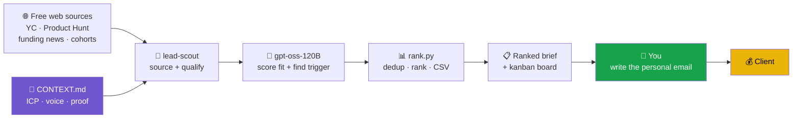

<div align="center">

# GenSync Prospector ⛏️

### Find the right founders. Write the mail yourself.

**AI does the groundwork. You do the personalization.**

Prospector is a [Hermes](https://github.com/NousResearch/hermes-agent) skill pack that scours the open web for
B2B startups worth reaching out to — and hands you a ranked brief with a real
trigger, the closest proof point, a public contact, and talking-point angles.
Then it gets out of your way, because **the message is the one thing that should
stay 100% human.**

[](LICENSE)


</div>

---

## Why this exists

Everyone is racing to make AI write the outreach. That's backwards.

When every inbox is full of the same auto-generated "Hi {first_name}, I noticed
you're the {title} at {company}…" slop, the *only* thing that still books a call
is a message a human actually wrote — because they actually looked.

So Prospector flips it:

> **Let the machine do the boring, tedious, time-eating part** — finding the
> right companies, spotting the trigger, digging up the proof and the contact —
> **and let the human do the part that wins: the personal message.**

The AI does the dirty work. You get clients.

---

## What it does

Three skills, one shared brain (`CONTEXT.md` — your ICP, voice, proof and case
studies live in one file that every skill reads).

| Skill | What it does |
|-------|--------------|
| 🔎 **`lead-scout`** | Scours free public sources → a **ranked prospect brief**: company, real trigger, matching case study, *public* contact, and 2–3 angles you turn into your own email. |
| 📄 **`proposal`** | Turns a scope conversation into a tight one-page proposal + price framing that drives to a working call. |
| ✍️ **`copy`** | Landing pages, case-study writeups and founder content — in your brand voice, proof-led, zero buzzwords. |

---

## How it works



**AI owns everything up to the brief. You own the message.** That green box is
the whole point.

---

## Sample brief

Real output from `rank.py` (leads ranked by *fit × how fresh the trigger is*):

```markdown
# GenSync Prospects
_3 qualified, ranked by fit x trigger recency._

## 1. Loamly  |  score 0.7671
- What: usage-based billing infra for B2B SaaS
- Who: Tom Vashee  |  Contact: tom@loamly.io
- Trigger: launched on Product Hunt (#2 of the day)  (2026-09-28)
- Fit: closest proof = HotelFirst
- Angle (your talking points - you write the mail):
    - founder is camera-ready but has zero founder-content cadence
    - PH momentum is decaying - needs proof clips now
    - HotelFirst: one 3-hr shoot became a 3-month runway
- source: https://www.producthunt.com/products/loamly

## 2. Fernwehr  |  score 0.7369
- What: CI observability for platform teams
- Who: Ana Reddy  |  Contact: @anareddy
- Trigger: raised $3.2M seed (Accel)  (2026-09-24)
- Fit: closest proof = ConnectME
- Angle (your talking points - you write the mail):
    - landing page buries the product under 'AI-native' jargon
    - seed close = 8-week launch window
    - we rebranded + shipped ConnectME's site in one pass
- source: https://techcrunch.com/2026/09/24/fernwehr-seed
```

You read three bullets, you know exactly why this founder should care, you write
four sentences that only you could have written. That's the loop.

---

## Quick start

**Requires:** [Hermes Agent](https://github.com/NousResearch/hermes-agent) with an LLM configured, and Python 3.9+.

```bash
git clone https://github.com/pramodkrishnaa/gensync-prospector.git
cd gensync-prospector

# Windows
./install.ps1
# macOS / Linux
./install.sh
```

The installer copies the `gensync` skill pack into your Hermes skills directory
(`$HERMES_HOME/skills/`). Then, from Hermes (CLI, desktop, or Telegram):

```
Run gensync-lead-scout for recently funded B2B SaaS startups.
Draft a gensync proposal for Loamly — they need a launch film + landing page.
Write gensync landing-page copy for a devtools launch.
```

**Make it your own:** edit `skills/gensync/CONTEXT.md` — that one file defines
who you target, your voice, and your proof. Everything else reads from it.

### Run it every morning (optional)

```bash
hermes cron add --schedule "0 9 * * 1-5" \
  --message "Run gensync-lead-scout for recently funded B2B startups; post the top 5 ranked prospects."
```

A fresh list of people worth emailing, in your chat, before your coffee.

---

## Design principles

- **Research is automated; outreach is not.** No skill sends or ghostwrites a
  single email. Ever.
- **No guessed contacts.** Only genuinely public emails/handles make the brief —
  guessing patterns is how you become spam.
- **Every claim is sourced.** Each lead carries a `source_url` you can verify in
  one click. No hallucinated triggers, no invented metrics.
- **Quality over volume.** Five sharp, well-triggered leads beat fifty guesses.
- **$0 to run.** Built to run on a self-hosted open model (gpt-oss-120B), but
  works with any LLM Hermes supports.

---

## Repo structure

```
gensync-prospector/
├── skills/gensync/
│   ├── CONTEXT.md              # the brain: ICP · voice · proof (edit this)
│   ├── lead-scout/
│   │   ├── SKILL.md            # source → qualify → brief pipeline
│   │   └── scripts/rank.py     # deterministic dedup · rank · CSV (self-tested)
│   ├── proposal/SKILL.md
│   └── copy/SKILL.md
├── install.ps1 / install.sh
└── README.md
```

`rank.py` ships a self-test: `python skills/gensync/lead-scout/scripts/rank.py --selftest`.

---

## Roadmap

- [ ] RAG over past outreach so the agent learns which angles book calls
- [ ] Reply-tracking on the kanban board (New → Contacted → Replied → Call booked)
- [ ] Pluggable source connectors (paid lead APIs) once free sourcing proves the channel

---

<div align="center">

Built for **[GenSync](https://gensync.in)** — GTM launches · product films · growth systems.

*The tedious part is the machine's job. The human part is yours.*

</div>
